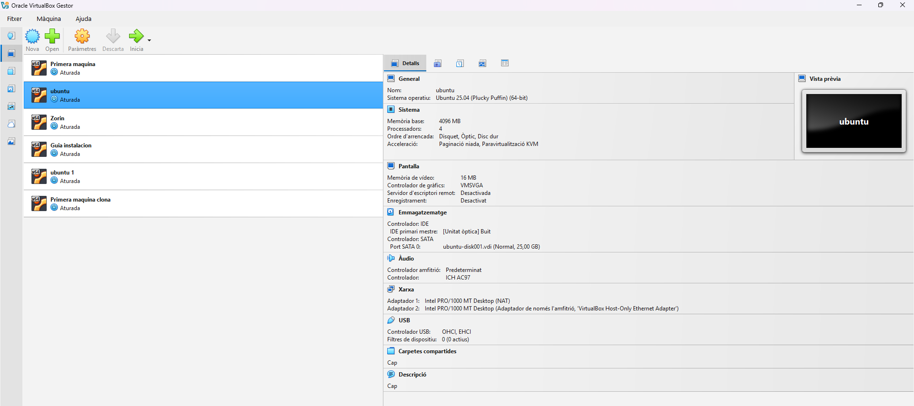

# Fitxa tècnica: Instal·lació d'Ubuntu Server a VirtualBox

## Objectiu

Instal·lar Ubuntu Server en una màquina virtual amb VirtualBox i deixar-la preparada per poder fer pràctiques.

## Materials

- Ordinador amb VirtualBox instal·lat
- Imatge ISO d'Ubuntu Server
- Connexió a Internet

## Procediment
1. Obrir VirtualBox i crear una màquina virtual nova.
2. Posar un nom a la màquina virtual i seleccionar Linux com a sistema operatiu.
3. Assignar la memòria RAM i l'espai de disc necessari.
4. Afegir la imatge ISO d'Ubuntu Server.
5. Iniciar la màquina virtual i començar la instal·lació.
6. Seleccionar l'idioma i configurar el teclat.
7. Configurar l'usuari, el nom del servidor i la contrasenya.
8. Esperar que acabi la instal·lació i reiniciar la màquina virtual.
9. Iniciar sessió amb l'usuari creat.

Per comprovar la configuració de xarxa podem utilitzar aquesta comanda:

```bash
ip a
```
### Imatge del procés


## Comprovacions
- [ ] La màquina virtual s'inicia correctament.
- [ ] Ubuntu Server arrenca sense errors.
- [ ] Puc iniciar sessió amb l'usuari creat.
- [ ] La màquina virtual té connexió a la xarxa.

## Incidències i solucions
| Incidència | Solució |
|---|---|
| La màquina virtual no arrenca des de la ISO | Revisar que la imatge ISO estigui seleccionada a la configuració de la màquina virtual |
| No hi ha connexió a Internet | Comprovar la configuració de xarxa de VirtualBox |

## Flux de treball amb Git

Durant l'activitat he anat fent els canvis per parts. Amb `git status` he comprovat l'estat dels fitxers i amb `git diff` he revisat els canvis abans de guardar-los.

Després he utilitzat `git add` per preparar els fitxers i `git commit` per guardar cada canvi amb un missatge descriptiu. Finalment, he sincronitzat els commits amb GitHub.

## Recursos
- [Documentació oficial d'Ubuntu Server](https://ubuntu.com/server/docs)
- [Documentació de VirtualBox](https://www.virtualbox.org/wiki/Documentation)